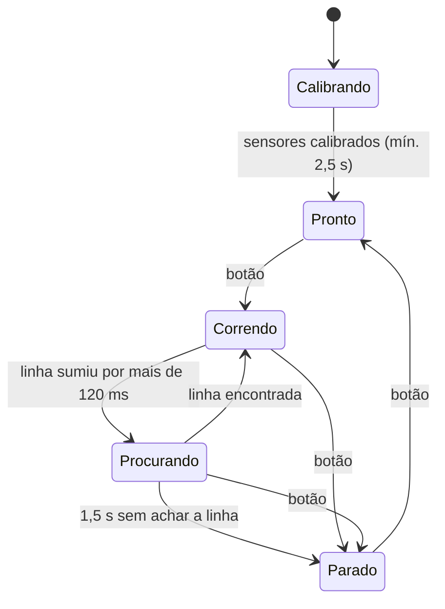

# Seguidor de Linha com PID


Firmware de um **robô seguidor de linha** para **Arduino Uno/Nano** e **ESP32**, escrito em C++ com PlatformIO. Ele usa controle **PID**, uma barra de sensores de refletância e uma máquina de estados que calibra, corre, procura a linha quando ela some e para por segurança.

Toda a lógica de controle fica separada do hardware e tem **testes automatizados que rodam no computador**, sem precisar do robô.

## Como funciona



1. **Calibração:** o robô gira no lugar, passando os sensores sobre a linha e o fundo, e guarda o mínimo e o máximo de cada sensor
2. **Leitura da linha:** os valores são normalizados (0 = branco, 1000 = preto), e a posição sai de uma **média ponderada** dos sensores. O resultado vira um erro de -1 (linha à esquerda) a +1 (à direita)
3. **PID:** a correção vem do erro e é somada a uma roda e subtraída da outra
4. **Linha perdida:** o erro fica saturado no lado em que a linha foi vista por último, e o robô gira para lá. Falhas curtas (cruzamentos, fita falhada) são toleradas

### Detalhes do PID

- **Anti-windup:** o termo integral fica preso nos limites da saída. Depois de uma curva longa, o controle não "lembra" demais e responde logo
- **Filtro no derivativo:** um passa-baixa reduz o ruído dos sensores
- **dt real:** o intervalo vem de `millis()`, e o código continua correto quando o `millis()` dá a volta (cerca de 49 dias)

## Estrutura

```text
lib/Pid/                 controlador PID (C++ puro)
lib/LineSensor/          calibração, normalização e posição da linha (C++ puro)
lib/Robot/               máquina de estados e mistura das rodas (C++ puro)
src/main.cpp             liga a lógica ao hardware (Arduino)
include/config.h         pinos por placa, ganhos e velocidades
test/                    24 testes Unity da lógica
```

A divisão é proposital: o que depende do Arduino fica só em `src/main.cpp`. Todo o resto compila no PC e é testado.

## Hardware

| Componente | Uso |
|---|---|
| Arduino Uno/Nano **ou** ESP32 DevKit | controle |
| Barra de sensores analógicos (tipo QTR-8A) | 6 sensores no Uno, 8 no ESP32 |
| Ponte H TB6612FNG | 2 motores DC com redução |
| Botão + LED | iniciar/parar e indicar o estado |

| Sinal | Uno/Nano | ESP32 |
|---|---|---|
| Sensores | A0–A5 | 36, 39, 34, 35, 32, 33, 25, 26 |
| Motor esquerdo (PWMA, AIN1, AIN2) | 5, 7, 8 | 16, 17, 5 |
| Motor direito (PWMB, BIN1, BIN2) | 6, 4, 2 | 18, 19, 21 |
| STBY da ponte H | 12 | 22 |
| Botão (com pull-up interno) | 3 | 0 (BOOT) |

O LED pisca rápido calibrando, pisca devagar quando está pronto e fica aceso correndo.

## Compilar, gravar e testar

```bash
pip install platformio

pio run -e uno -t upload          # Arduino Uno
pio run -e esp32dev -t upload     # ESP32
pio device monitor                # telemetria em CSV (115200 baud)
pio test -e native                # testes da lógica no computador
```

A telemetria (`estado,erro,correcao,esquerda,direita`) pode ser vista em gráfico no Serial Plotter da IDE do Arduino. Isso ajuda muito a ajustar o PID.

No Arduino Uno, o firmware usa **19,5% da RAM** (400 de 2048 bytes) e **22,8% da flash**.

## Ajustando na pista

Os ganhos ficam em `include/config.h`. O erro vai de -1 a +1, e a saída é em PWM (0 a 255).

1. Comece com `KI = 0` e `KD = 0`. Aumente o `KP` até o robô seguir as curvas, mesmo oscilando
2. Aumente o `KD` até a oscilação ("serpentear") sumir
3. Só use `KI` se o robô ficar sempre deslocado para um lado em retas longas
4. Depois aumente o `BASE_SPEED` aos poucos, reajustando o `KD`

## Testes

São 24 testes com **Unity**, rodando no computador (`pio test -e native`):

- **PID:** proporcional, saturação, integral ao longo do tempo, anti-windup, derivativo, filtro, reset e `dt = 0`
- **Sensores:** exigência de calibração, normalização, linha no centro, nas bordas e entre dois sensores, linha perdida mantendo o lado e ruído ignorado
- **Robô:** cada transição da máquina de estados, tolerância a falhas curtas, parada de segurança, estouro do `millis()` e mistura das rodas

O GitHub Actions roda os testes e compila o firmware para **Arduino Uno e ESP32** a cada push.

---

<details>
<summary>English</summary>

### PID Line Follower Firmware

C++17 firmware (PlatformIO) for a line-following robot on **Arduino Uno/Nano and ESP32**: sensor calibration, weighted line position, a **PID controller with anti-windup and a filtered derivative**, and a state machine (calibrating → ready → running → searching → stopped) with a safety stop. All control logic is hardware-independent and covered by **24 Unity tests that run on the PC**; CI builds the firmware for both boards. Uses 19.5% of the Uno's RAM.

</details>
